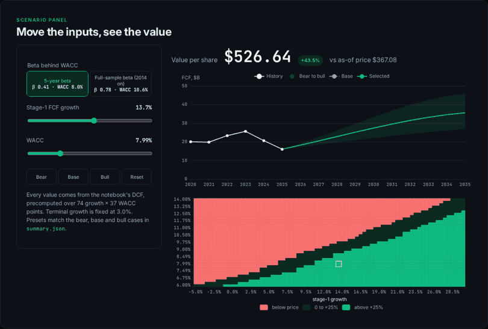
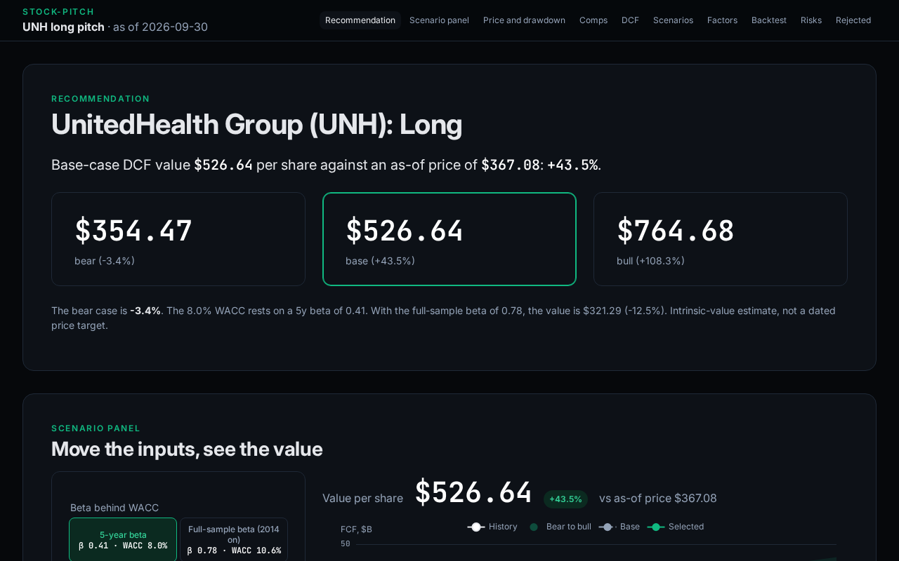
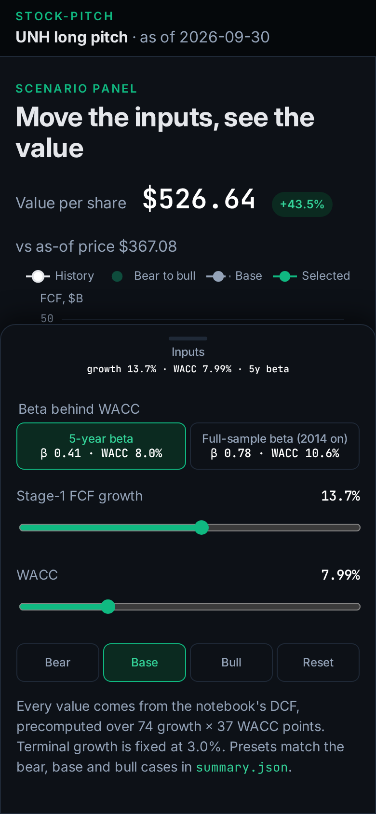
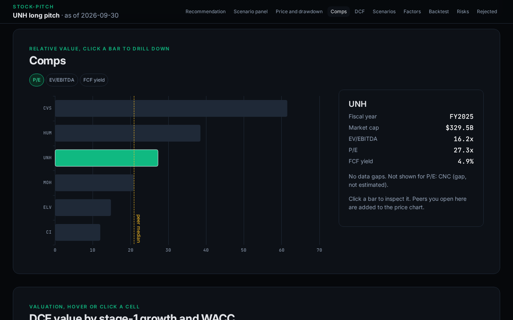
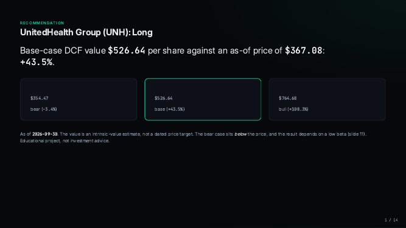

# UNH long pitch

<a href="https://github.com/ParBproject/stock-pitch/actions/workflows/ci.yml"></a>

**[Web deck](https://parbproject.github.io/stock-pitch/)** · **[PDF deck](deck/pitch.pdf)** · [HTML deck](https://parbproject.github.io/stock-pitch/deck/) · [Results](results/summary.json)

Long equity pitch on UnitedHealth Group. The notebooks rebuild the charts from frozen snapshots. Numbers in the deck, the web app and the sections below come from [`results/summary.json`](results/summary.json), and the tests check them.



## The pitch

<!-- pitch:start -->
**Long UNH** at an as-of price of **$367.08** (2026-09-30). Base-case DCF value **$526.64** (43.5% upside); target range $354.47 to $764.68.

| | Bear | Base | Bull |
|---|---|---|---|
| Stage-1 FCF growth | 7.6% | 13.7% | 19.4% |
| WACC | 8.49% | 7.99% | 7.49% |
| Value per share | $354.47 | $526.64 | $764.68 |
| vs price | -3.4% | 43.5% | 108.3% |

- **What the price implies:** a reverse DCF says the market prices in 6.0% stage-1 FCF growth, against 13.7% in the base case (the median of the stock's rolling 5-year FCF CAGRs).
- **Discount rate:** CAPM with rf 5.3%, 5-year beta 0.41, ERP 8.3%, giving WACC 7.99%. Terminal growth 3.0%, 10-year fade.
- **Backtest** (2017-01-03 to 2026-09-30, walk-forward, out-of-sample, net of 10 bp costs), Sharpe with rf = 0: trend signal 0.29, buy-and-hold 0.49, SPY 0.87.

### Risks

- **Beta.** A 5-year beta of 0.41 gives WACC 7.99% and $526.64. The full-sample beta (0.78) gives WACC 10.55% and **$321.29 (-12.5%)**, below the price. Factor-model R² is 0.23.
- **Bear case.** $354.47 (-3.4%), below the price.
- **FCF.** $25.7B in FY2023 to $16.1B in FY2025. Base-case growth is still the median of the rolling 5-year FCF growth rates.
- **Margins.** Operating margin 4.2% in FY2025, against 8.7% in FY2023 (the peak-FCF year).
- **Drawdown and the signal.** Max drawdown -61.4% vs -33.7% for SPY since 2014-01-03. The trend signal and buy-and-hold both trail SPY on Sharpe.
<!-- pitch:end -->

## Contents

| | |
|---|---|
| [Web deck](https://parbproject.github.io/stock-pitch/) | Prices, comps, DCF heatmap, factor betas, backtest |
| [Scenario panel](https://parbproject.github.io/stock-pitch/#p-panel) | Growth, WACC and beta on the same DCF, with a fan chart and a sensitivity heatmap |
| [PDF deck](deck/pitch.pdf) | HTML deck exported to PDF |
| [Style guide](https://parbproject.github.io/stock-pitch/deck/style-guide.html) | Tokens, components, contrast checks |
| [Notebooks](notebooks/) | Screen, factor model, comps, DCF, risk and backtest, scenarios |
| [`results/summary.json`](results/summary.json) | The figures, with a source on each assumption |

| Desktop | Mobile |
|---|---|
|  |  |
|  |  |

## Method

- **Screen.** Liquid US large-caps, scored on coverage, peer set, testability and market-cap rank ([`results/screen.json`](results/screen.json)). Visa ranked first. Its DCF was below the price, so that case is archived. This pitch is the next eligible name, with Costco run on the same code as a comparison.
- **Valuation.** Two-stage FCF DCF, linear fade to terminal growth, reverse DCF, bear/base/bull from the stock's own rolling FCF growth, and a growth by WACC grid.
- **Discount rate.** CAPM from the 10-year Treasury, a daily beta against SPY on the recent window (full-sample beta is reported beside it) and the Ken French equity risk premium. Cost of debt and the tax rate come from the 10-K.
- **Factors.** Fama-French five factors plus momentum, Newey-West t-stats, rolling betas.
- **Comps.** EV/EBITDA, P/E and FCF yield against the managed-care peer median. Missing filings stay blank.
- **Risk.** Volatility, beta, max drawdown, historical VaR and expected shortfall.
- **Signal.** Walk-forward trend filter against buy-and-hold and SPY, out of sample, net of a stated cost.

## Data

Snapshots are frozen at the pitch date. SHA-256 manifests are in `data/raw_UNH/` (and `data/raw/`, `data/raw_COST/`):
Yahoo Finance daily prices, SEC EDGAR XBRL 10-K facts (as first reported, filed on or before the as-of date),
the FRED Treasury yield, and the Ken French data library. Gaps are listed in the summary and left blank.

**SEC User-Agent.** EDGAR asks clients for a `"Name email"` User-Agent. The code reads `SEC_USER_AGENT`.
If that is unset it uses `Par Bahrae githubproproject@proton.me`. GitHub Actions reads the `SEC_USER_AGENT` repository secret.
Set your own before a re-fetch: `export SEC_USER_AGENT="Your Name you@example.com"`.

## Reproduce

```bash
git clone https://github.com/ParBproject/stock-pitch && cd stock-pitch
python -m venv .venv && . .venv/bin/activate
pip install -e ".[dev]" && python -m playwright install chromium
make all     # offline: screen, notebooks, summary, deck, PDF, web build, ruff, pytest (needs Node 20+ for the web build)
make data    # optional: re-fetch snapshots (network; changes the results, so review the diff)
```

The web deck is `web/dist` pushed to the `gh-pages` branch. `scripts/shoot_readme.py` refreshes the images above.

## Appendix: screen and the other names

<!-- screen:start -->
**Chosen stock: V** (as of 2026-09-30). Shortlist: V, UNH, COST.

| Ticker | Industry | Peers | Coverage | Peer set | Testability | Recognisability | Total | Eligible |
|---|---|---|---|---|---|---|---|---|
| V | Credit Services | 6 | 0.75 | 0.75 | 1.00 | 0.87 | 0.843 | yes |
| UNH | Healthcare Plans | 6 | 1.00 | 0.75 | 1.00 | 0.43 | 0.794 | yes |
| COST | Discount Stores | 6 | 1.00 | 0.75 | 0.83 | 0.50 | 0.772 | yes |
| JPM | Banks - Diversified | 3 | 1.00 | 0.38 | 1.00 | 1.00 | 0.844 | no: only 3 same-industry peers (< 5) |
| HD | Home Improvement Retail | 2 | 1.00 | 0.25 | 0.50 | 0.37 | 0.529 | no: only 2 same-industry peers (< 5) |

Excluded (used by the DCF project): AAPL, MSFT, KO, JNJ, CAT, XOM.
<!-- screen:end -->

<!-- m3:start -->
| Ticker | Price | DCF value | Upside | Bear | Base | Bull | WACC | Price-implied growth | Sharpe B&H | Supports long? |
|---|---|---|---|---|---|---|---|---|---|---|
| UNH | 367.08 | 526.64 | 43.5% | 354.47 | 526.64 | 764.68 | 8.0% | 6.0% | 0.49 | yes (base case) |
| COST | 910.34 | 410.96 | -54.9% | 284.63 | 410.96 | 496.94 | 10.9% | 38.5% | 0.99 | no |

### UNH (active pitch)
- **DCF (base):** 526.64 per share vs as-of price 367.08, so upside is **43.5%**. WACC 8.0%, stage-1 growth 13.7%, terminal growth 3.0%.
- **Reverse DCF:** the price implies 6.0% stage-1 FCF growth, fading to terminal over 10 years.
- **Scenarios:** bear 354.47 (-3.4%), base 526.64 (43.5%), bull 764.68 (108.3%).
- **Factor betas** (2014-01-03 to 2026-08-31, R² 0.23): Mkt-RF +0.82 (t 13.3), SMB -0.12 (t -2.0), HML +0.13 (t 1.8), RMW +0.26 (t 4.3), CMA +0.09 (t 0.8), Mom +0.08 (t 1.7). Alpha 5.9% a year (t 0.81).
- **Backtest** (2017-01-03 to 2026-09-30, out-of-sample, net of costs), Sharpe with rf = 0: trend strategy 0.29, buy-and-hold UNH 0.49, SPY 0.87.

### COST (compared, same methods; [`results/compare/COST_summary.json`](results/compare/COST_summary.json))
- **DCF (base):** 410.96 per share vs as-of price 910.34, so upside is **-54.9%**. WACC 10.9%, stage-1 growth 16.3%, terminal growth 3.0%.
- **Reverse DCF:** the price implies 38.5% stage-1 FCF growth, fading to terminal over 10 years.
- **Scenarios:** bear 284.63 (-68.7%), base 410.96 (-54.9%), bull 496.94 (-45.4%).
- **Factor betas** (2014-01-03 to 2026-08-31, R² 0.36): Mkt-RF +0.72 (t 23.2), SMB -0.13 (t -3.4), HML -0.29 (t -7.0), RMW +0.51 (t 10.8), CMA +0.18 (t 2.4), Mom +0.04 (t 1.5). Alpha 8.2% a year (t 1.74).
- **Backtest** (2017-01-03 to 2026-09-30, out-of-sample, net of costs), Sharpe with rf = 0: trend strategy 0.59, buy-and-hold COST 0.99, SPY 0.87.

### V (archived first pick; [`results/archive/V_summary.json`](results/archive/V_summary.json))
*First screen pick. The base DCF was 199.15 against a 359.33 price (-44.6%), the bull case was -25.5%, and the price implied 28.4% stage-1 FCF growth against a 12.9% historical median. The pitch moved to the next name on the shortlist, using the same assumptions.*
- **DCF (base):** 199.15 per share vs as-of price 359.33, so upside is **-44.6%**. WACC 11.6%, stage-1 growth 12.9%, terminal growth 3.0%.
- **Reverse DCF:** the price implies 28.4% stage-1 FCF growth, fading to terminal over 10 years.
- **Scenarios:** bear 166.71 (-53.6%), base 199.15 (-44.6%), bull 267.85 (-25.5%).
- **Factor betas** (2014-01-03 to 2026-08-31, R² 0.53): Mkt-RF +1.01 (t 40.6), SMB -0.20 (t -4.9), HML +0.09 (t 1.9), RMW +0.22 (t 4.0), CMA -0.13 (t -1.7), Mom -0.04 (t -1.2). Alpha 3.5% a year (t 0.83).
- **Backtest** (2017-01-03 to 2026-09-30, out-of-sample, net of costs), Sharpe with rf = 0: trend strategy 0.10, buy-and-hold V 0.79, SPY 0.87.
<!-- m3:end -->

*Not investment advice. Educational project; no position is held.*
