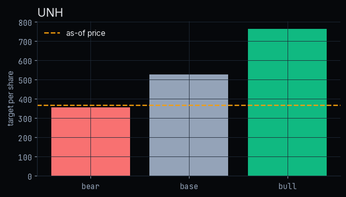
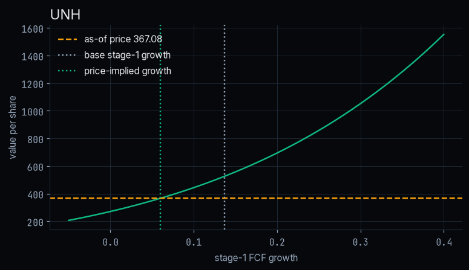
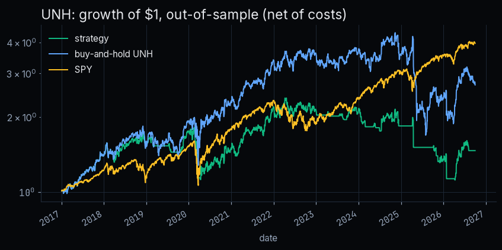

# stock-pitch

A long-only equity pitch built like a quant research project: every number in the deck comes from
committed data snapshots and code in this repo, and tests pin the headline figures.

Planned deliverables: an interactive HTML web deck (with PDF export) and a static scenario panel on
GitHub Pages. This repo is built one milestone at a time.

## M1: stock selection

Five liquid US large-caps were screened on four equally weighted criteria using frozen free data
(Yahoo Finance prices and industry labels, SEC EDGAR XBRL company facts). Candidates need at least
10 years of price history and at least 5 peers that share their Yahoo Finance industry label.

<!-- screen:start -->
**Chosen stock: V** (as of 2026-09-30). Shortlist: V, UNH, COST.

| Ticker | Industry | Peers | Coverage | Peer set | Testability | Recognisability | Total | Eligible |
|---|---|---|---|---|---|---|---|---|
| V | Credit Services | 6 | 0.75 | 0.75 | 1.00 | 0.87 | 0.843 | yes |
| UNH | Healthcare Plans | 6 | 1.00 | 0.75 | 1.00 | 0.43 | 0.794 | yes |
| COST | Discount Stores | 6 | 1.00 | 0.75 | 0.83 | 0.50 | 0.772 | yes |
| JPM | Banks - Diversified | 3 | 1.00 | 0.38 | 1.00 | 1.00 | 0.844 | no: only 3 same-industry peers (< 5) |
| HD | Home Improvement Retail | 2 | 1.00 | 0.25 | 0.50 | 0.37 | 0.529 | no: only 2 same-industry peers (< 5) |

Excluded (used by the DCF project): AAPL, MSFT, KO, JNJ, CAT, XOM.
<!-- screen:end -->

Scores and method live in [`results/screen.json`](results/screen.json); this table is rendered from
it by `scripts/build_screen.py`, and `tests/` checks they match. Snapshot sources and SHA-256 hashes are
in [`data/manifest.json`](data/manifest.json).

## M2: data and repo skeleton

All snapshots for **V** are frozen as of **2026-09-30** in [`data/raw/`](data/raw), with sources and SHA-256 hashes in [`data/raw/manifest.json`](data/raw/manifest.json):

- **Prices:** daily adjusted close and volume from Yahoo Finance for V, peers MA, AXP, PYPL, COF, SYF and ALLY, and benchmark SPY, from 2014.
- **Factors:** Ken French Fama/French 5 factors and momentum, daily. The latest library release ends **2026-08-31**, a month before the as-of date.
- **Fundamentals:** SEC EDGAR XBRL 10-K annual facts, kept only if filed on or before the as-of date. Each value is the figure as first reported, with the filing accession number. V's fiscal 2026 10-K is filed after the as-of date, so FY2025 is the latest year.
- **Known gaps:** XBRL has no unsegmented diluted EPS or diluted share count for V, which reports by share class. ALLY, COF and SYF don't report operating income, and SYF has no revenue line. These gaps are listed in `results/summary.json` and are never filled with estimates.

`src/pitch/data.py` provides offline loaders that check the hashes. `results/summary.json` holds the data coverage now. Its analysis fields stay `null` until M3 computes them. `make all` rebuilds the screen, the summary and the notebooks, then runs lint and tests offline. `make data` re-fetches the data, which needs a network connection.

## M3: analysis (re-picked: UNH)

Notebooks `02` to `06` compute everything below from frozen snapshots and write figures to [`figures/<TICKER>/`](figures). V, the first pick, showed no upside, so the pitch moved to **UNH**, the next stock on the M1 shortlist. UNH and COST (the third on the shortlist) were run with **the same code, methods and assumptions as V**, with nothing tuned. Each ticker's data sits in its own `data/raw_<TICKER>/` folder with hashes. All numbers are in [`results/summary.json`](results/summary.json), with the source of every assumption and WACC input. Tests pin these numbers.

<!-- m3:start -->
| Ticker | Price | DCF value | Upside | Bear | Base | Bull | WACC | Price-implied growth | Sharpe B&H | Supports long? |
|---|---|---|---|---|---|---|---|---|---|---|
| UNH | 367.08 | 526.64 | 43.5% | 354.47 | 526.64 | 764.68 | 8.0% | 6.0% | 0.49 | yes (base case) |
| COST | 910.34 | 410.96 | -54.9% | 284.63 | 410.96 | 496.94 | 10.9% | 38.5% | 0.99 | no |

### UNH (active pitch)
- **DCF (base):** 526.64 per share vs as-of price 367.08, so upside is **43.5%**. WACC 8.0%, stage-1 growth 13.7%, terminal growth 3.0%.
- **Reverse DCF:** the price implies 6.0% stage-1 FCF growth, fading to terminal over 10 years.
- **Scenarios:** bear 354.47 (-3.4%), base 526.64 (43.5%), bull 764.68 (108.3%).
- **Factor betas** (2014-01-03 to 2026-08-31, R² 0.23): Mkt-RF +0.82 (t 13.3), SMB -0.12 (t -2.0), HML +0.13 (t 1.8), RMW +0.26 (t 4.3), CMA +0.09 (t 0.8), Mom +0.08 (t 1.7). Alpha 5.9% a year (t 0.81).
- **Backtest** (2017-01-03 to 2026-09-30, out-of-sample, net of costs), Sharpe with rf = 0: trend strategy 0.29, buy-and-hold UNH 0.49, SPY 0.87.

### COST (compared, same methods; [`results/compare/COST_summary.json`](results/compare/COST_summary.json))
- **DCF (base):** 410.96 per share vs as-of price 910.34, so upside is **-54.9%**. WACC 10.9%, stage-1 growth 16.3%, terminal growth 3.0%.
- **Reverse DCF:** the price implies 38.5% stage-1 FCF growth, fading to terminal over 10 years.
- **Scenarios:** bear 284.63 (-68.7%), base 410.96 (-54.9%), bull 496.94 (-45.4%).
- **Factor betas** (2014-01-03 to 2026-08-31, R² 0.36): Mkt-RF +0.72 (t 23.2), SMB -0.13 (t -3.4), HML -0.29 (t -7.0), RMW +0.51 (t 10.8), CMA +0.18 (t 2.4), Mom +0.04 (t 1.5). Alpha 8.2% a year (t 1.74).
- **Backtest** (2017-01-03 to 2026-09-30, out-of-sample, net of costs), Sharpe with rf = 0: trend strategy 0.59, buy-and-hold COST 0.99, SPY 0.87.

### V (archived first pick; [`results/archive/V_summary.json`](results/archive/V_summary.json))
*Dropped after M3: the base DCF gave 199.15 vs a 359.33 price (-44.6%), even the bull case was -25.5%, and the price implied 28.4% stage-1 FCF growth vs a 12.9% historical median. Frank re-picked from the shortlist with the same methods and assumptions (no tuning).*
- **DCF (base):** 199.15 per share vs as-of price 359.33, so upside is **-44.6%**. WACC 11.6%, stage-1 growth 12.9%, terminal growth 3.0%.
- **Reverse DCF:** the price implies 28.4% stage-1 FCF growth, fading to terminal over 10 years.
- **Scenarios:** bear 166.71 (-53.6%), base 199.15 (-44.6%), bull 267.85 (-25.5%).
- **Factor betas** (2014-01-03 to 2026-08-31, R² 0.53): Mkt-RF +1.01 (t 40.6), SMB -0.20 (t -4.9), HML +0.09 (t 1.9), RMW +0.22 (t 4.0), CMA -0.13 (t -1.7), Mom -0.04 (t -1.2). Alpha 3.5% a year (t 0.83).
- **Backtest** (2017-01-03 to 2026-09-30, out-of-sample, net of costs), Sharpe with rf = 0: trend strategy 0.10, buy-and-hold V 0.79, SPY 0.87.
<!-- m3:end -->

**Reading this honestly:**
- UNH is the only one of the three whose base-case DCF is above its price (+43.5%), and the price implies only 6.0% stage-1 FCF growth.
- Its bear case is slightly below the price (−3.4%), so this is a long thesis with downside, not a margin of safety in every scenario.
- **UNH caveats to address in the deck:**
  - The 8.0% WACC rests on a low 5-year beta of 0.41. That beta reflects a period when UNH's own news dominated its returns (R² 0.23).
  - FY2025 FCF ($16.1B) is down from $25.7B in FY2023, while stage-1 growth uses the long-run median of 13.7%.
  - The trend signal and buy-and-hold both lag SPY on Sharpe.
- COST and V both price in far more growth than their history supports.





## M4: the deck

- **Web deck:** [`deck/index.html`](deck/index.html), 12 slides plus two appendix slides. Use ← → to move between slides.
- **PDF:** [`deck/pitch.pdf`](deck/pitch.pdf).
- **Build:** both are generated from `results/summary.json` and the committed UNH figures by `scripts/build_deck.py` and `scripts/export_deck.py` (Playwright Chromium).
- **Tests:** `tests/test_deck.py` checks every number on the slides against the JSON, and fails if any digit appears in slide text that doesn't come from the JSON.
- **Content:** the risks and scenarios slides state the bear case, the low-beta WACC (and what the full-sample beta does to it), the decline in FCF, and the Sharpe ratios that trail SPY. The appendix covers V and COST as rejected candidates.

## M5: design system

- **Tokens:** [`design/tokens.json`](design/tokens.json) is the single source for:
  - colors: #06080b background, #10B981 accent
  - type: Inter on a 12/14/16/20/28/40 scale, with JetBrains Mono for tabular numbers (fonts are self-hosted, under the OFL license)
  - layout: a 12-column grid on an 8px scale
  - motion: 200 to 300 ms, which drops to 0 under `prefers-reduced-motion`
- **Generated files:** `src/pitch/design.py` turns the tokens into `deck/assets/tokens.css`, `components.css` and `deck.css`, and builds the [style guide](deck/style-guide.html). The style guide includes WCAG AA contrast checks for every text pair.
- **Charts:** the chart theme in `src/pitch/plotting.py` reads the same tokens.
- **Tests:** `tests/test_design.py` checks contrast, the motion range and the reduced-motion rule, that the generated CSS is current, and that components use tokens only.

## Reproduce

```bash
pip install -e ".[dev]"
make all     # offline: screen, summary, notebooks, ruff, pytest
make data    # optional: re-fetch snapshots (network; changes results)
```

Not investment advice. Educational portfolio project.
