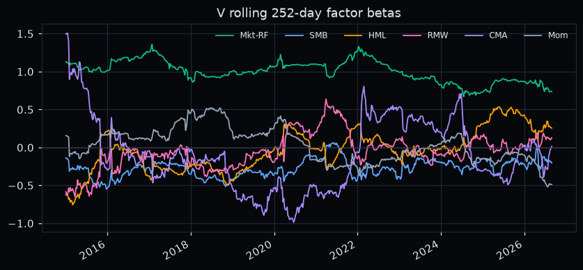
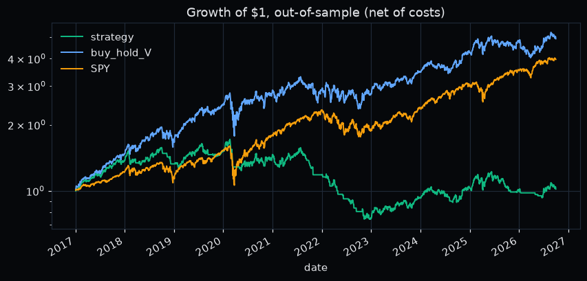
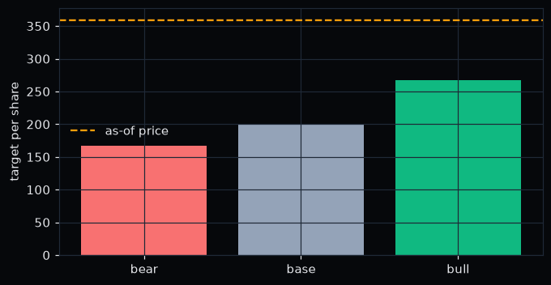

# stock-pitch

A long-only equity pitch built like a quant research project: every number in the deck comes from
committed data snapshots and code in this repo, and tests pin the headline figures.

Planned deliverables: an interactive HTML web deck (with PDF export) and a static scenario panel on
GitHub Pages. This repo is built one milestone at a time.

## M1: stock selection

Five liquid US large-caps were screened on four equally weighted criteria using frozen free data
(Yahoo Finance prices and industry labels, SEC EDGAR XBRL company facts). Candidates need at least
10 years of price history and at least 5 peers that share their Yahoo Finance industry label.

<!-- screen:start -->
**Chosen stock: V** (as of 2026-09-30). Shortlist: V, UNH, COST.

| Ticker | Industry | Peers | Coverage | Peer set | Testability | Recognisability | Total | Eligible |
|---|---|---|---|---|---|---|---|---|
| V | Credit Services | 6 | 0.75 | 0.75 | 1.00 | 0.87 | 0.843 | yes |
| UNH | Healthcare Plans | 6 | 1.00 | 0.75 | 1.00 | 0.43 | 0.794 | yes |
| COST | Discount Stores | 6 | 1.00 | 0.75 | 0.83 | 0.50 | 0.772 | yes |
| JPM | Banks - Diversified | 3 | 1.00 | 0.38 | 1.00 | 1.00 | 0.844 | no: only 3 same-industry peers (< 5) |
| HD | Home Improvement Retail | 2 | 1.00 | 0.25 | 0.50 | 0.37 | 0.529 | no: only 2 same-industry peers (< 5) |

Excluded (used by the DCF project): AAPL, MSFT, KO, JNJ, CAT, XOM.
<!-- screen:end -->

Scores and method live in [`results/screen.json`](results/screen.json); this table is rendered from
it by `scripts/build_screen.py`, and `tests/` checks they match. Snapshot sources and SHA-256 hashes are
in [`data/manifest.json`](data/manifest.json).

## M2: data and repo skeleton

All snapshots for **V** are frozen as of **2026-09-30** in [`data/raw/`](data/raw), with sources and SHA-256 hashes in [`data/raw/manifest.json`](data/raw/manifest.json):

- **Prices:** daily adjusted close and volume from Yahoo Finance for V, peers MA, AXP, PYPL, COF, SYF and ALLY, and benchmark SPY, from 2014.
- **Factors:** Ken French Fama/French 5 factors and momentum, daily. The latest library release ends **2026-08-31**, a month before the as-of date.
- **Fundamentals:** SEC EDGAR XBRL 10-K annual facts, kept only if filed on or before the as-of date. Each value is the figure as first reported, with the filing accession number. V's fiscal 2026 10-K is filed after the as-of date, so FY2025 is the latest year.
- **Known gaps:** XBRL has no unsegmented diluted EPS or diluted share count for V, which reports by share class. ALLY, COF and SYF don't report operating income, and SYF has no revenue line. These gaps are listed in `results/summary.json` and are never filled with estimates.

`src/pitch/data.py` provides offline loaders that check the hashes. `results/summary.json` holds the data coverage now. Its analysis fields stay `null` until M3 computes them. `make all` rebuilds the screen, the summary and the notebooks, then runs lint and tests offline. `make data` re-fetches the data, which needs a network connection.

## M3: analysis

Notebooks `02` to `06` compute everything below from the frozen snapshots and write figures to [`figures/`](figures). All numbers are in [`results/summary.json`](results/summary.json), with the source of every assumption and WACC input. Tests pin these numbers.

<!-- m3:start -->
- **DCF (base):** 199.15 per share vs as-of price 359.33, so upside is **-44.6%**. WACC 11.6%, stage-1 growth 12.9%, terminal growth 3.0%.
- **Reverse DCF:** the price implies 28.4% stage-1 FCF growth, fading to terminal over 10 years.
- **Scenarios:** bear 166.71 (-53.6%), base 199.15 (-44.6%), bull 267.85 (-25.5%).
- **Factor betas** (2014-01-03 to 2026-08-31, R² 0.53): Mkt-RF +1.01 (t 40.6), SMB -0.20 (t -4.9), HML +0.09 (t 1.9), RMW +0.22 (t 4.0), CMA -0.13 (t -1.7), Mom -0.04 (t -1.2). Alpha 3.5% a year (t 0.83).
- **Backtest** (2017-01-03 to 2026-09-30, out-of-sample, net of costs), Sharpe with rf = 0: trend strategy 0.10, buy-and-hold V 0.79, SPY 0.87.
<!-- m3:end -->

**Reading this honestly:** under these inputs the DCF does **not** support a long position. The price implies much faster FCF growth than V's own history. The walk-forward trend signal also failed to beat buy-and-hold. The main caveats are listed below.
- The ERP is the long-run arithmetic mean, which is high.
- The 10-year yield on the as-of date is 5.29%.
- The share count is from Yahoo.
- The DCF discounting convention is conservative.

M4 has to address this before the deck takes a side.





## Reproduce

```bash
pip install -e ".[dev]"
make all     # offline: screen, summary, notebooks, ruff, pytest
make data    # optional: re-fetch snapshots (network; changes results)
```

Not investment advice. Educational portfolio project.
